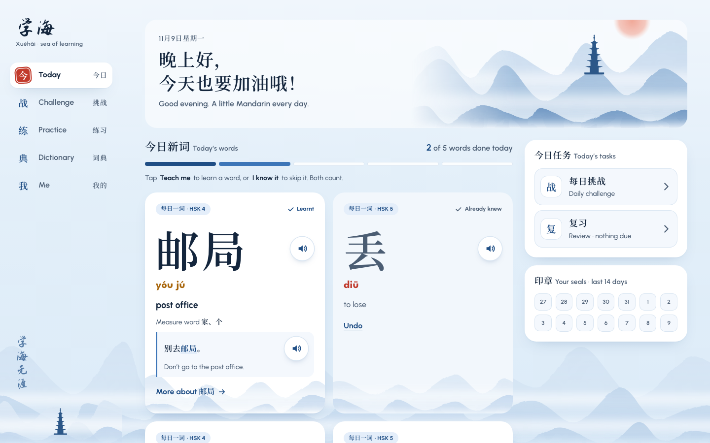
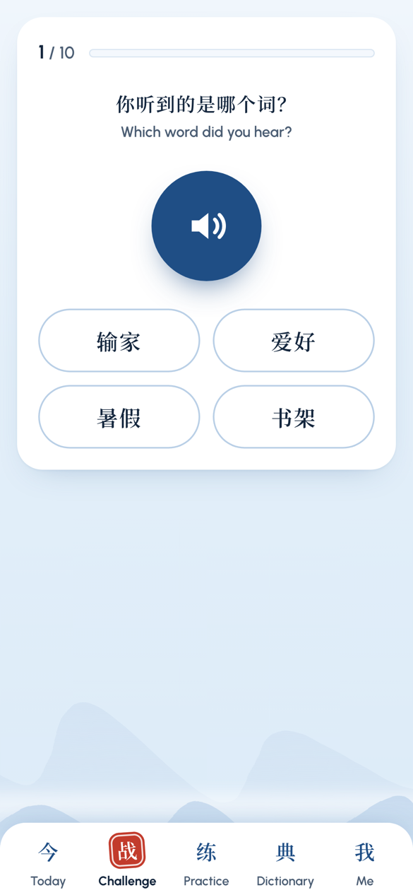
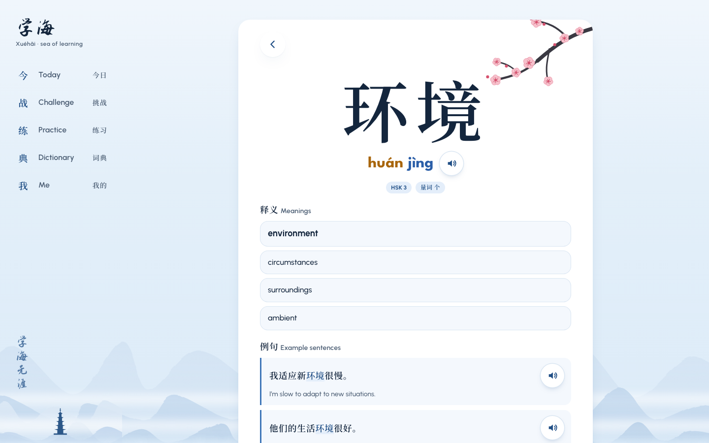
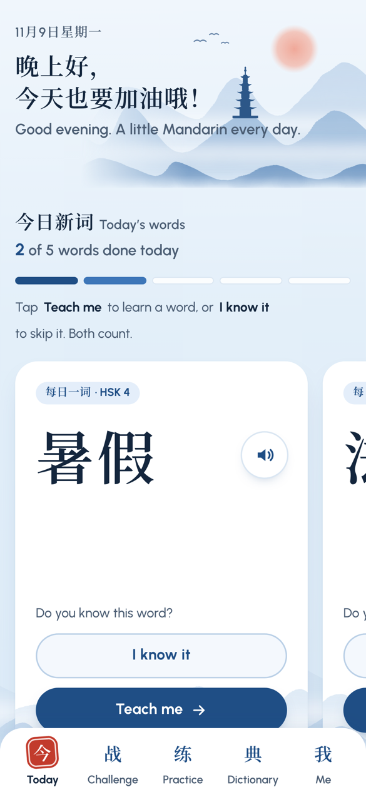

# 学海 Xuéhǎi · sea of learning

**A calm, ink-wash Mandarin app for people who already speak some Chinese and want to get better.**

**Try it:** **https://xuehai-damia.netlify.app**. It works on phone and laptop, can be installed to your home screen, and works offline.

<p>
  
  
</p>

The name comes from the idiom 学海无涯, "the sea of learning has no shore".

---

## What it does

| | |
|---|---|
| **今日 Today** | A few new words every day, picked from your HSK levels. Each card shows the 汉字 first. Tap **Teach me** to learn it or **I know it** to skip it; both count toward your daily goal. Learnt cards show the meaning, measure word and an example sentence. |
| **战 Daily challenge** | Ten questions a day mixing meanings, tones, listening and measure words. Questions are asked in Chinese with English underneath. Finishing earns a red seal 印章 and keeps your streak going. Leave halfway and it picks up where you stopped. |
| **练 Practice** | Unlimited extra quizzes. Choose due reviews, your levels or all your words, a question type and a length. It also resumes where you left off. |
| **典 Dictionary** | About 122,000 words, searchable by 汉字, pinyin (tones optional: `nihao`, `ni3hao3` and `nǐhǎo` all work) or English. |
| **Word page** | Pronunciation, meanings, up to 3 example sentences 例句, other readings, and links to each character. |
| **我 Me** | Today's goal ring, streak and word counts, plus settings: words per day, HSK levels, tone colours, voice and speed. |
| **我的词语 My words** | Every word you've learnt, with search, filters (in review, due, mastered, already knew), a level filter and sorting. |

<p>
  
  
</p>

**How reviewing works:** words you learn come back after 1, 2, 4, 7, 15, 30 and then 60 days. A wrong answer sends a word back to the start. After 4 right answers in a row, a word counts as *mastered*.

**Simplified Chinese only.** Traditional characters are never shown.

**Your progress stays on your device.** There's no account and no server. Progress is saved in the browser, so each device keeps its own progress for now.

## Built with

- [React](https://react.dev) + [TypeScript](https://www.typescriptlang.org), bundled with [Vite](https://vite.dev)
- Plain CSS (CSS Modules), with hand-drawn SVG scenery. No UI library.
- [vite-plugin-pwa](https://vite-pwa-org.netlify.app) for install and offline support
- The browser's built-in speech engine (Web Speech API) for pronunciation
- [Vitest](https://vitest.dev) for unit tests; [Playwright](https://playwright.dev) for browser tests on phone, tablet and laptop sizes
- Hosted on [Netlify](https://www.netlify.com)

## Run it on your computer

You need **Node 22** (see `.nvmrc`).

```bash
npm install
npm run dev          # then open http://localhost:5173
```

| Command | What it does |
|---|---|
| `npm run dev` | Start the app locally; it reloads as you edit |
| `npm test` | Run the unit tests (the rules: daily words, quizzes, reviews, search…) |
| `npm run e2e` | Run the browser tests on phone, tablet and laptop sizes (first time: `npx playwright install chromium`) |
| `npm run lint` | Check the code for common mistakes |
| `npm run build` | Make the production version in `dist/` |
| `npm run data` | Rebuild the word data in `public/data/` from the original sources (only needed to update the data) |

## Deploying

```bash
npm run build
npx netlify-cli deploy --prod --dir dist
```

Build settings, redirects and cache headers are in `netlify.toml`.

## Project layout

```
src/
  pages/        one file per screen (Today, Challenge, Practice, Dictionary, Word, Me, My words, Welcome)
  components/   reusable pieces (word card, quiz, search box, seal, scenery…)
  lib/          the rules, with no screen code: daily words, quizzes, reviews, search, pinyin, speech
  state/        everything the app remembers, and the only place it changes (reducer.ts)
  data/         loads the word lists and example sentences
  hooks/        small shared helpers for pages
  styles/       colours, fonts, sizes
scripts/        turns the raw dictionaries into the app's data files
public/data/    the generated data: hsk.json, cedict.txt, examples.json
e2e/            browser tests
docs/           screenshots for this README
```

The design system (colours, fonts, spacing, components) is described in [`DESIGN.md`](DESIGN.md).

## Data and credits

- **Dictionary:** [CC-CEDICT](https://www.mdbg.net/chinese/dictionary?page=cc-cedict), CC BY-SA 4.0
- **HSK 3.0 word lists:** [complete-hsk-vocabulary](https://github.com/drkameleon/complete-hsk-vocabulary) by drkameleon, MIT
- **Example sentences:** [Tatoeba](https://tatoeba.org), CC BY 2.0 FR. Filtered to simplified Chinese, at most 3 per word, easiest first.
- **Fonts:** Noto Serif SC, League Spartan, Urbanist, Cormorant Garamond and Zhi Mang Xing (the 学海 brush logo), all SIL Open Font License
